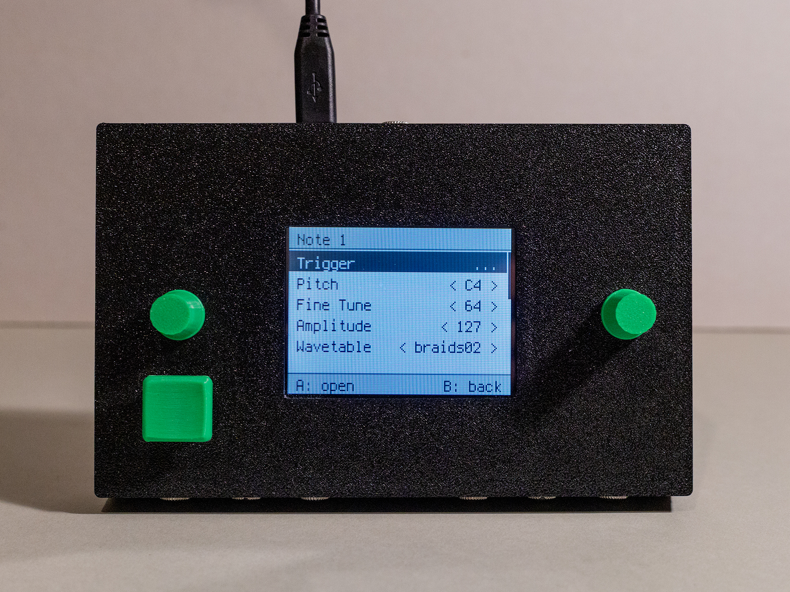
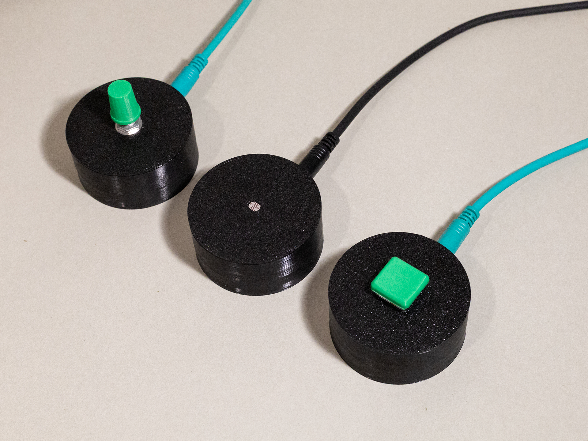
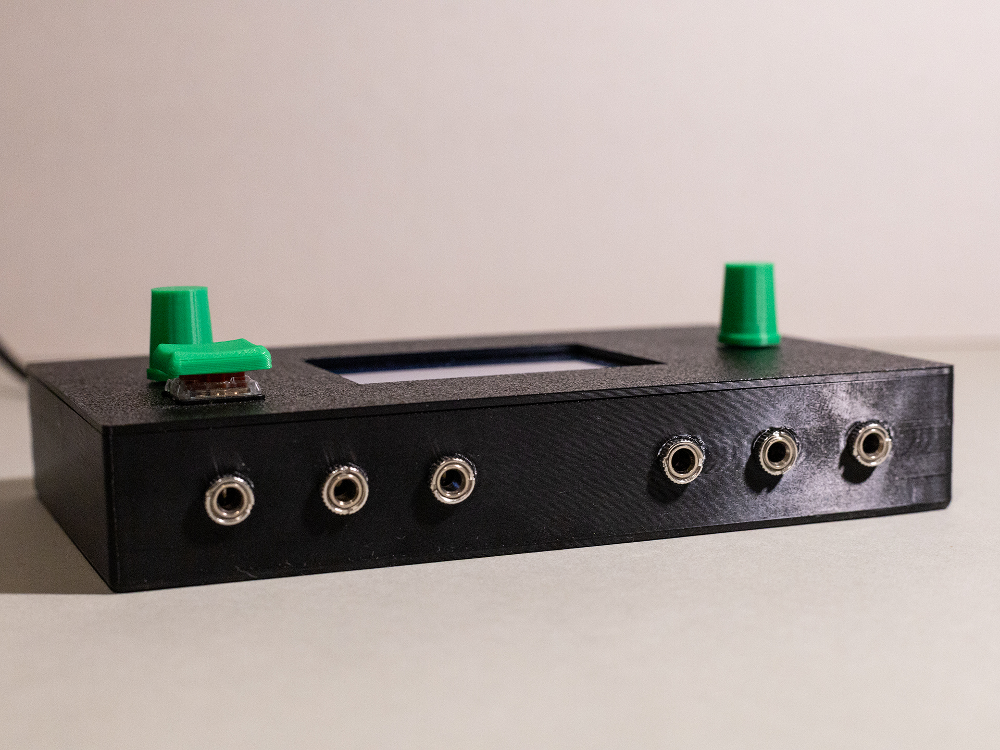
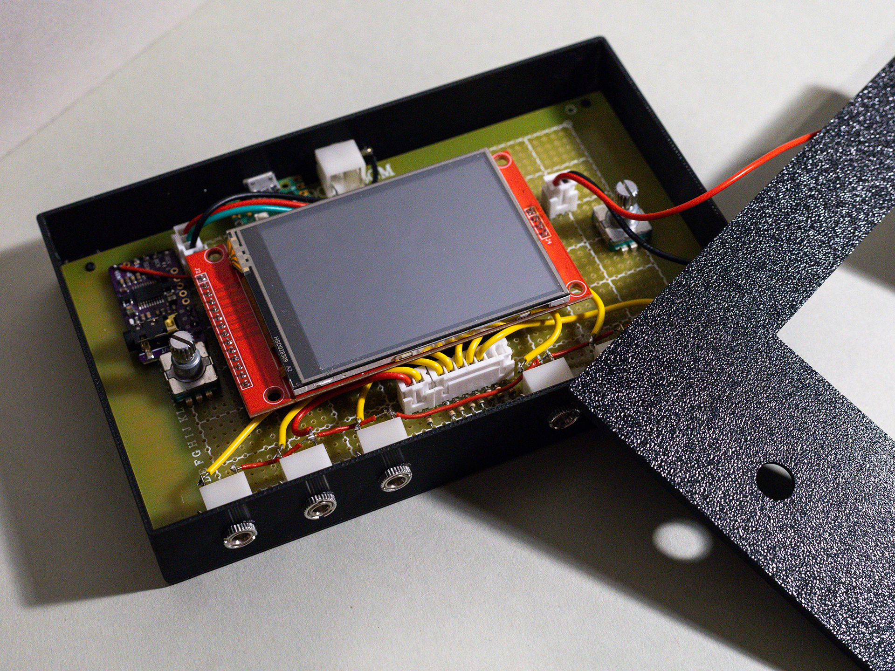
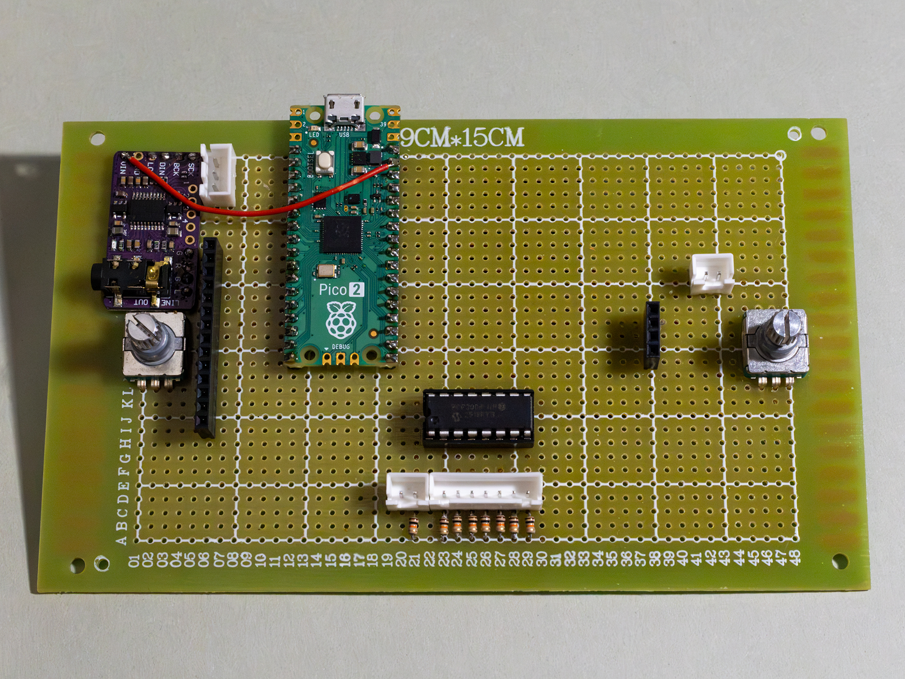
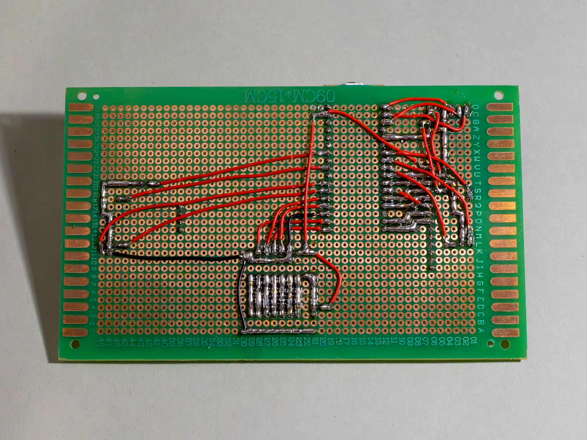
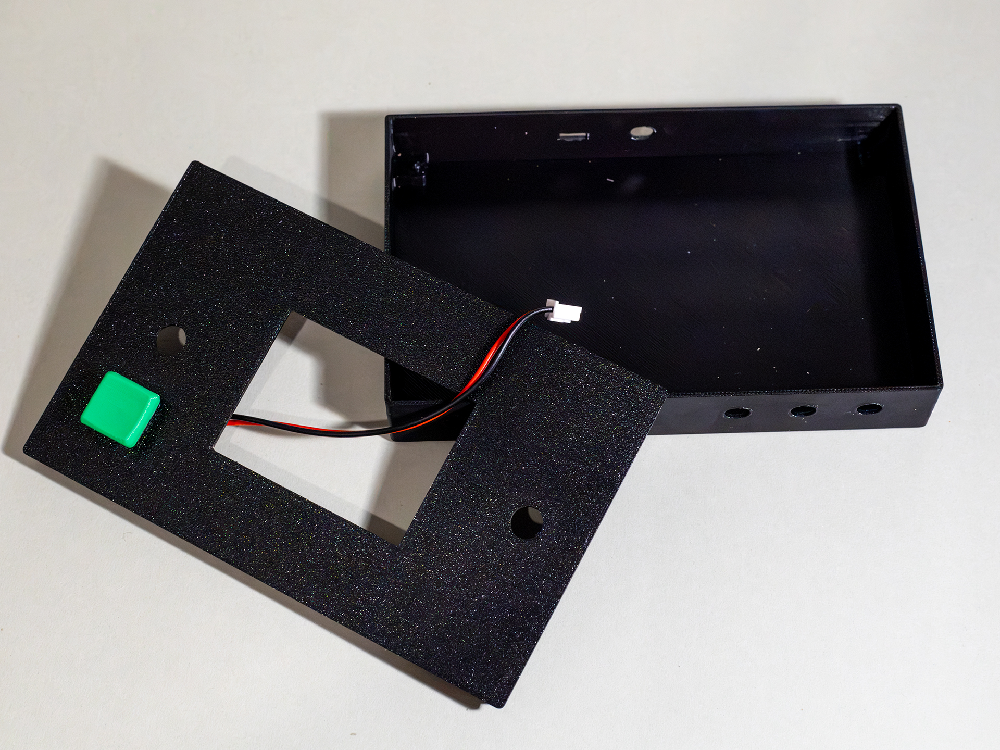
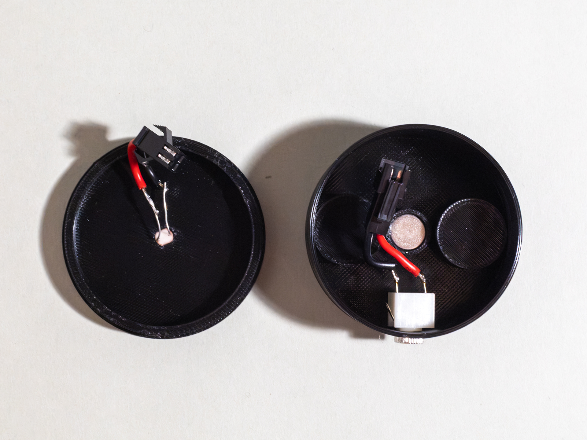

# Polvo — DIY Modular Performance Synthesizer



Polvo is a DIY synthesizer designed for use on stage. You can configure wavetable synth patches on its 2.8-inch display before playing them using the modular performance modules. These modules are plastic discs that can be fitted with photoresistors, switches or potentiometers, and are connected using Eurorack cables. You can use the modules to control any number of parameters introduced in the patch.

In terms of hardware, it uses a Raspberry Pi Pico 2, an inexpensive PCM5102 DAC and an ILI9341 display. The wavetable synthesis is handled by [CircuitPython](https://circuitpython.org/) and the [synthio](https://docs.circuitpython.org/en/stable/shared-bindings/synthio/) library, while [picogame](https://picogame.makerclass.cz/) and [picogui](https://github.com/MakerClassCZ/picogui) handle drawing to the display and GUI respectively.

I built this synth using simple perfboard ([see below](#perfboard-build)), but users are encouraged to design their own PCB for fewer soldering connections, or even their own modules with different types of sensors and buttons.

<p align="center">
  
  &nbsp;
  
  &nbsp;
  
</p>

---

## Hardware

### Synthesizer

| Component | Description |
|-----------|--------|
| Microcontroller | Raspberry Pi Pico 2. This is the full-size development board from Raspberry Pi, although you could use any RP2350 board with enough I/O. RP2040 boards should also work |
| Display | [MSP2807](https://www.lcdwiki.com/2.8inch_SPI_Module_ILI9341_SKU:MSP2807). ILI9341, 2.8-inch, 320x240 TFT. I used the generic red board with an SPI-only interface, touchscreen and an SD card slot, although I didn't use either of these features |
| DAC | PCM5102A generic purple board
| ADC | [MCP3008 IC](https://cdn-shop.adafruit.com/datasheets/MCP3008.pdf). Used to obtain readings of the modules
| Resistors | (8x) 10 kΩ
| Encoders | (2x) [SR PASSIVES EC11E12-15P30C-SW](https://www.tme.eu/en/details/ec11e12-15p30c-sw/incremental-type-encoders/sr-passives/) (15imp/revol with switch) |
| Switch | Kailh 1350 Low Profile Choc (linear Red)
| 3.5mm jacks | (7x) [Ninigi JC-204S](https://www.tme.eu/en/details/jc-204s/jack-connectors/ninigi/). These were the cheapest option available to me. Any connector that fits within the space constraints is fine. You only need a stereo connector for the DAC output; the connectors for the modules can be mono
| JST XH male/female connectors | (1x) 2-pin, (1x) 3-pin, (1x) 9-pin. As I didn't have any 9-pin connectors, I used one 2-pin and one 7-pin instead
| Male/female pin headers | Mainly used for making the display detachable from the board
| Knobs and keycaps | You could try picking up panel extension knobs, but it might be easier to 3D print your own, like I did. Any Kailh Choc keycap will work for the Shift button, but I also 3D printed a model I found online ([see below](#3d-models-and-printing))

### Modules

| Component | Description |
|-----------|--------|
| Photoresistor (LDR) | GL5516 Ø5mm (5–10 kΩ at 10 lx)
| Potentiometer | 5 kΩ
| Switch | Kailh 1350 Low Profile Choc (linear Red)
| 3.5mm jack | [Ninigi JC-204S](https://www.tme.eu/en/details/jc-204s/jack-connectors/ninigi/)
| JST SM male/female connectors | These make assembly and disassembly solderless
| Magnet | Ø10x5mm Neodymium N52
| Extra weight | (20x) 1-cent euro coins

---

## Wavetables

Polvo uses wavetables that are stored as standard WAVE files. Each wavetable contains 64 waveforms, one after the other, with 256 samples in each waveform. I took this idea from [todbot's Synthio Tutorial](https://todbot.github.io/CircuitPython_Synthio_Tutorial/README-4-Oscillators-Wavetables.html#use-a-wavetable). The website that originally shared these wavetables no longer exists, but todbot has [archived them in his repository](https://github.com/todbot/CircuitPython_Synthio_Tutorial/releases/download/0.3/wav-files-waveeditonline-Jul2023.zip).

To load these files into the synthesizer, connect the device to your computer via USB while holding down the Shift button — I will explain why this is necessary [later](#libraries-and-dependencies) — then move the wavetables to a new folder called `wavetables` on the `CIRCUITPY` drive.

The wavetable scanning code was heavily inspired by [todbot's Tutorial](https://todbot.github.io/CircuitPython_Synthio_Tutorial/README-4-Oscillators-Wavetables.html#wavetable-scanning).

---

## Libraries and Dependencies

To speed up the process of drawing to the display, Polvo uses [`picogame`](https://picogame.makerclass.cz), a CircuitPython game engine with optimizations for display updates. It also provides useful libraries such as `picogame_clock`.

**Using `picogame` on a custom board like mine requires installing the [appropriate firmware](https://picogame.makerclass.cz/supported-hardware/#download-firmware) (pico2.uf2)** and copying a [special boot.py file](https://github.com/MakerClassCZ/picogame/tree/main/custom_board/firmware_boot) to the `CIRCUITPY` drive.

I further modified this file to enable or disable read-only mode at boot depending on whether the Shift button is pressed. This is necessary in order to save the patches created using the GUI (more information can be found [here](https://learn.adafruit.com/circuitpython-essentials/circuitpython-storage)). **You can use the boot.py file available in this repository** or patch your own.

The GUI was built using [`picogui`](https://github.com/MakerClassCZ/picogui), a configuration UI toolkit for CircuitPython written by the creator of picogame. **You can use [`circup`](https://docs.circuitpython.org/projects/circup/en/latest/)**, a tool for managing and updating libraries on a CircuitPython device, **to install `picogui` and all the dependencies for this project**.

```
python -m venv venv
venv/bin/pip install circup

venv/bin/circup install adafruit_mcp3xxx adafruit_wave

venv/bin/circup bundle-add MakerClassCZ/picogame-libs
venv/bin/circup install picogame_clock picogame_input

venv/bin/circup bundle-add MakerClassCZ/picogui
venv/bin/circup install picogui picogui_dialog picogui_picogame picogui_records picogui_themes
```

---

## Perfboard Build

I built the circuit on a 90x150mm perfboard because I'm impatient and I dislike waiting for PCBs to arrive in the post, only to realise that I've made a mistake and have to bodge it or order a new revision. Having said that, I used [DIY Layout Creator](https://github.com/bancika/diy-layout-creator) to plan the wiring and included both that project and some KiCad schematics in the `schematics` folder of this repository.

<p align="center">
  
  &nbsp;
  
</p>

---

## 3D Models and Printing

I modelled the cases for the synth and the control modules using FreeCAD and then printed them on my Bambu Lab A1. They require no fasteners and are friction-fitted instead.

Although the MCP3008 ADC I used has eight channels, all of which are wired to resistors and JST connectors on the board, I decided to allow space for only six jacks to reduce the density of the build. However, you can modify the case to accommodate eight jacks instead.

The bottom part of the module case features a slot for a magnet, allowing users to attach it to magnetic surfaces. There are also slots for two stacks of ten 1-cent euro coins, which make the module feel more substantial and less likely to move around. When printing, users should set a pause marker in their preferred slicing software for the layer immediately before the slots are covered. They should then resume the print after placing the coins.

The FreeCAD projects and STL files for all the models can be found in the `3d_models` folder of this repository. The encoder and potentiometer knobs were generated using [this OpenSCAD script](https://github.com/Alex-Kent/OpenSCAD_Customizable_Knob), and the Kailh Choc switch keycap model that I used is available [here](https://www.thingiverse.com/thing:4564253).

<p align="center">
  
  &nbsp;
  
</p>

---

## Planned Features

- Add a menu for batch calibration of control modules.
- Implement MIDI support over USB and DIN.
- Explore digital communication between the synthesizer and control modules.
- Design a custom PCB to replace the current perfboard layout.

---

## Notes

- All photos in this `README` were taken by Diana Paiva.
- The project's concept, code and documentation were developed by a human (myself), with some basic assistance from ChatGPT and DeepL Writer.